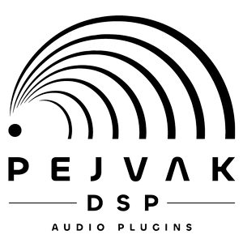
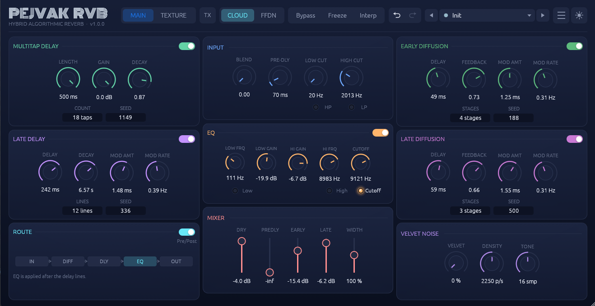
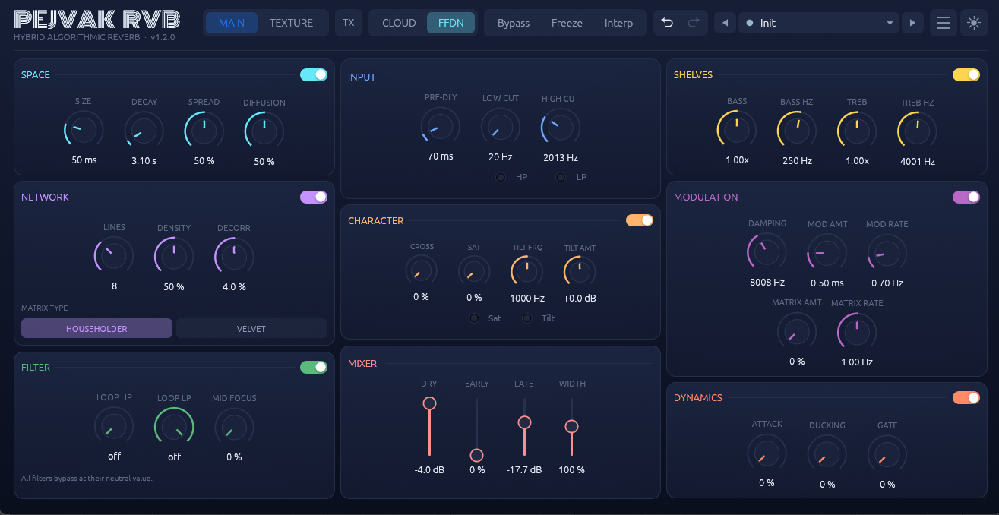
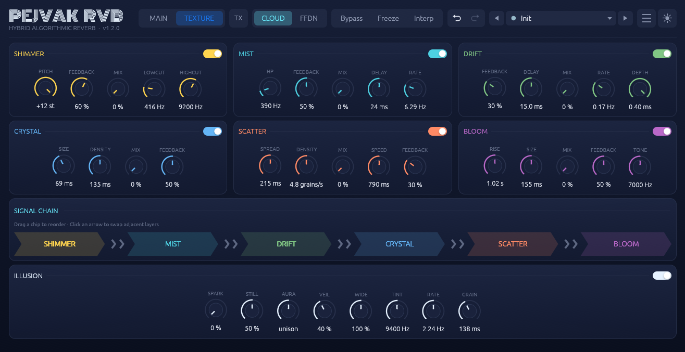

<div align="center">

<!-- ===== LOGO ===== -->


# 🎛️ PEJVAK RVB

**A Professional Hybrid Algorithmic Reverb — Dual Engine. Pure Rust.**

[](https://github.com/Pejvak-DSP/PejvakRVB/releases)
[](LICENSE)
[](https://www.rust-lang.org)
[](https://github.com/Pejvak-DSP/PejvakRVB/releases)

[](https://steinbergmedia.github.io/vst3_dev_portal/)
[](https://cleveraudio.org)
[](https://github.com/Pejvak-DSP)

</div>

<br>

> **PEJVAK RVB** is a high-end algorithmic reverb plugin written entirely in Rust. It combines two completely independent DSP engines in a single package — a faithful port of the legendary CloudSeed, and a modern Filtered Feedback Delay Network (FFDN) — and layers a rich, click-free texture system on top.
>
> **Design Goals:** Pure `f64` DSP, zero allocation on the audio thread, SIMD where it is bit-exact, and a UI that feels as good as it sounds.

---

## Table of Contents

- [Features](#-features)
- [Security & Reliability](#️-security--reliability)
- [Screenshots](#-screenshots)
- [Installation](#-installation)
- [Building from Source](#️-building-from-source)
- [Project Structure](#-project-structure)
- [Contributing](#-contributing)
- [Credits](#-credits)
- [License](#-license)

---

## ✨ Features

### 🌌 Dual Engine Architecture

Switch seamlessly between two distinct worlds of reverb:

| Engine | Character | Highlights |
| :--- | :--- | :--- |
| **☁️ CloudSeed** | Warm, dense, and deep | Faithful port of [Valdemar Erlingsson's *CloudSeed* (legacy-v1)](https://github.com/ValdemarOrn/CloudSeed/tree/legacy-v1). 49 parameters, deep early-diffusion front-end, and Velvet-Noise diffusion. |
| **🌐 FFDN** | Clean, modern, and characterful | Filtered Feedback Delay Network. Features Householder & Velvet matrices, frequency-dependent attenuation, loop HP/LP filtering, mid-focus, modulated delay lines, Velvet saturation, spectral tilt, early reflections, and 3 dynamics stages (Attack / Ducking / Gate). |

*Switching engines instantly clears the departing engine's buffers, ensuring zero bleed-over from stale tails.*

### 🎨 Texture Rack (6 Layers)

Available on **both** engines. Drag the chips in the Signal Chain to reorder them:

- **Shimmer:** Granular pitch shifter inside a feedback loop.
- **Mist:** Short modulated delay with light feedback.
- **Drift:** Very slow pitch wobble.
- **Crystal:** Dual grain readers in a shared buffer.
- **Scatter:** Overlapping grains with random start positions.
- **Bloom:** Slow-rising reverse-reverb character.

*Every layer features a 20 ms anti-click smoother and clears its buffers on the rising edge from zero.*

### 🔮 ILLUSION — Granular Cloud

A beautiful granular cloud with pitched overtones. Features 8 parameters (Spark, Still, Aura, Veil, Wide, Tint, Rate, Grain) and 8 independent anti-click techniques, including Catmull-Rom cubic interpolation, per-grain smoothstep fades, a DC blocker, and soft-clip saturation.

*Moving Spark from zero to any positive value fades the cloud in over one second, so the texture never "snaps" on at the very bottom of the knob range.*

### ⚡ SIMD Acceleration (Bit-Exact)

The DSP core uses the [`wide`](https://crates.io/crates/wide) crate to vectorize three hot loops with **four-lane `f64` SIMD**:

- Stereo input cross-blend (CloudSeed)
- Stereo input cross-blend (FFDN)
- Final M/S width stage (both engines)

The `wide` crate maps these operations to the widest vector instructions enabled at compile time (AVX on x86_64, NEON on ARM, with an SSE2 / scalar fallback elsewhere). **No FMA is used, and no reassociation is performed** — every SIMD operation is mathematically identical to the scalar reference, so the output is bit-for-bit the same as the non-SIMD path. This is enforced by the test suite.

### 🚀 Everything Else

- 🕹️ **Drag-and-Drop Signal Chain** with smooth animations and cursor feedback.
- ↩️ **Undo / Redo:** 50 steps with parameter-name tooltips. Undo never cuts the reverb tail.
- 🛑 **TX Kill Switch:** One-click master switch for all six texture layers and ILLUSION.
- 🎛️ **100 Factory Presets** across 16 color-coded categories.
- 🎨 **Dark / Light theme**, resizable UI (70% – 200%).
- 📖 **Bundled HTML Manual** with a sticky header, live search, and print-to-PDF support.
- 🔄 **Check for Updates:** Built-in update checker with SHA-256 verified downloads.
- 💾 **Full State Persistence:** Preset name, texture chain order, theme, window size, and UI preferences all survive a host reload.
- 🧹 **Clippy-clean, bit-identical DSP:** Every output-stage gain is per-sample smoothed, neutral settings are covered by `*_is_bit_identical` tests, and **49 tests** (42 DSP + 7 plugin) pass on every release.

---

## 🛡️ Security & Reliability

Building a plugin that runs inside a DAW means every millisecond counts and every failure mode is visible. PEJVAK RVB takes this seriously.

### Real-Time Safety

- **Zero heap allocation** inside `process()`. Every buffer is sized in `activate()` and reused in place.
- **No locks, no I/O, no panics** on the audio thread. All blocking work (file dialogs, preset scans, update checks) runs on background threads.
- **Panic latch:** The DSP chain is wrapped in `catch_unwind`. A first caught panic wipes every internal buffer and forces a clean re-push of all parameters, then continues. A second panic latches the engine into silence until the host calls `activate()` or `reset()` — a single bug can never take down the audio thread repeatedly.

### Smart Idle

When both the input and the output stay below **−100 dBFS** for **0.5 s**, the plugin enters sleep mode: `process()` returns immediately, saving CPU. A two-threshold hysteresis band (`WAKE_LEVEL = 10 × SLEEP_LEVEL`) prevents flapping on borderline signals. On wake, the internal buffers are cleared so the tail cannot bleed across the silence.

### Update Checker

The **Check for Updates** menu option is designed to be safe by default:

- **HTTPS-only** requests. ureq is configured with `https_only(true)`, so a malicious mirror cannot downgrade the connection to plaintext.
- **Streaming SHA-256 verification.** The installer is hashed as it downloads and compared against GitHub's immutable `digest` field. A mismatch aborts the install and deletes the partial file.
- **Explicit user confirmation.** The plugin never runs a downloaded binary without the user clicking through a checkbox that says *"I understand this will run an installer downloaded from the internet."*

### Input Validation

- **All XML presets** are parsed with `Option`-typed slots. A file missing half its parameters loads cleanly without resetting the user's state.
- **All parameter strings** are filtered for metacharacters before parsing, so a hostile `*.xml` cannot trigger shell commands or path traversal.
- **All CPU-side delay clamps** are defensive. `ModulatedAllpass`, `ModulatedDelay`, and `MultitapDiffuser` bound their internal indices against buffer length, so a future parameter-range change can never produce undefined behaviour inside an `unsafe` block.

---

## 📸 Screenshots

<div align="center">
  
  <br>
  <i>CloudSeed Engine — Warm and Dense</i>
</div>

<br>

<div align="center">
  
  <br>
  <i>FFDN Engine — Modern and Characterful</i>
</div>

<br>

<div align="center">
  
  <br>
  <i>Texture Rack &amp; ILLUSION</i>
</div>

---

## 📦 Installation

Download the installer for your platform from the [Releases](https://github.com/Pejvak-DSP/PejvakRVB/releases) page. Every release is built automatically by GitHub Actions on every supported platform.

### 🪟 Windows

Download **`PEJVAK-RVB-windows-x64-setup.exe`** and run it. The self-extracting installer:

1. Removes the *Mark of the Web* flag from the bundled plugin files (so Windows SmartScreen stops warning on load).
2. Creates the required VST3 and CLAP directories if they do not exist.
3. Copies `PEJVAK RVB.vst3` into `C:\Program Files\Common Files\VST3\` and `Pejvak_RVB.clap` into `C:\Program Files\Common Files\CLAP\`.
4. Pauses for confirmation once installation completes.

> **Note:** If Windows SmartScreen warns about the installer, click **More info → Run anyway**. This warning will disappear once the installer is code-signed with an Authenticode certificate.

### 🍎 macOS (Universal Binary)

Download **`PEJVAK-RVB-macos-universal.pkg`** and double-click it. This is a standard Apple package installer that:

1. Installs the VST3 and CLAP bundles into `~/Library/Audio/Plug-Ins/`.
2. Removes the Gatekeeper quarantine attribute from both plugins.

> **Note:** The package is universal — it runs natively on both Apple Silicon and Intel Macs.

### 🐧 Linux

Download **`PEJVAK-RVB-linux-x64.tar.gz`**, extract it, and run the following commands from the extracted folder:

```bash
# VST3
mkdir -p ~/.vst3/"PEJVAK RVB.vst3"/Contents/x86_64-linux
cp "PEJVAK RVB.vst3/Contents/x86_64-linux/PEJVAK RVB.so" ~/.vst3/"PEJVAK RVB.vst3"/Contents/x86_64-linux/

# CLAP
mkdir -p ~/.clap
cp Pejvak_RVB.clap ~/.clap/
```

> **Note:** The Linux build is compiled against the current Ubuntu LTS toolchain. It requires the standard `libx11`, `libxcb`, `libgl1`, and `libasound2` packages to be installed (they almost always are on a desktop system).

### 🔄 Updating

Once installed, use the **☰ menu → Check for updates** option inside the plugin. It will:

1. Query the GitHub Releases API and compare the remote tag against the installed version.
2. Show the release notes for any newer version.
3. Download the appropriate installer for your platform (with SHA-256 verification).
4. Offer a button to run the installer once you have closed your DAW.

---

## 🛠️ Building from Source

Ensure you have **Rust 1.98+** installed.
(Linux users also need X11 and OpenGL development libraries — see [CONTRIBUTING.md](CONTRIBUTING.md#development-setup).)

```bash
git clone https://github.com/Pejvak-DSP/PejvakRVB.git
cd PejvakRVB
cargo nice-plug bundle Pejvak_RVB --release
```

The bundled plugins will appear in `target/bundled/`.

### ✅ Verifying the Build

The DSP suite is bit-identical by design — every neutral/default value is covered by a `*_is_bit_identical` test, every stability-critical stage has a `*_keeps_network_stable` test, and every SIMD path is validated against the scalar reference. Before running the bundled plugins:

```bash
# 42 DSP tests, all passing
cargo test -p fdn_reverb_core

# 7 plugin tests (XML parser + parameter handling)
cargo test -p Pejvak_RVB

# zero warnings across both crates, including tests
cargo clippy --workspace --all-targets -- -D warnings
```

### 🍏 macOS Universal Binary

```bash
rustup target add aarch64-apple-darwin x86_64-apple-darwin
cargo build --target aarch64-apple-darwin --release
cargo build --target x86_64-apple-darwin --release

mkdir -p target/universal/release
lipo -create \
  target/aarch64-apple-darwin/release/libPejvak_RVB.dylib \
  target/x86_64-apple-darwin/release/libPejvak_RVB.dylib \
  -output target/universal/release/libPejvak_RVB.dylib
```

The full release pipeline (all three platforms, plus the Windows `.exe` and macOS `.pkg` installers) is defined in [`.github/workflows/release.yml`](.github/workflows/release.yml).

---

## 🧱 Project Structure

```text
PejvakRVB/
├── fdn_reverb_core/        ← Pure DSP core (CloudSeed, FFDN, Textures)
│   └── src/
│       ├── cloudseed/      ← Faithful CloudSeed port
│       ├── ffdn/           ← Filtered Feedback Delay Network
│       └── texture/        ← Six texture layers + ILLUSION
├── Pejvak_RVB/             ← Plugin wrapper (params, UI, presets)
│   └── src/
│       ├── lib.rs          ← Plugin definition & audio thread
│       ├── editor.rs       ← egui interface
│       ├── updater.rs      ← GitHub release checker
│       ├── manual.rs       ← HTML manual loader
│       └── presets.rs      ← 100 factory presets
├── egui-baseview-0.7.2/    ← Vendored + patched baseview backend
├── manual/                 ← Bundled HTML manual + logo
├── screenshots/            ← README images
├── .github/workflows/      ← Release CI (release.yml)
├── CHANGELOG.md
├── CONTRIBUTING.md
├── LICENSE
└── Cargo.toml              ← Workspace root
```

---

## 🤝 Contributing

Bug reports, feature requests, and pull requests are welcome. Please read [CONTRIBUTING.md](CONTRIBUTING.md) first — the real-time safety and DSP rules there are strict. See [CHANGELOG.md](CHANGELOG.md) for release history.

---

## 🙏 Credits

PEJVAK RVB stands on the shoulders of giants. Huge thanks to:

- **CloudSeed** — [Valdemar Erlingsson](https://github.com/ValdemarOrn/CloudSeed/tree/legacy-v1) (the original reference implementation)
- **CloudReverb** — [xunil-cloud](https://github.com/xunil-cloud/CloudReverb) (JUCE fork & modern parameter layout)
- **FFDN Theory** — Fagerström et al., "Velvet-Noise Feedback Delay Network" (DAFx 2020); Schlecht & Habets (IEEE TSP 2017); Välimäki et al. (IEEE/ACM TASLP 2017)
- **Granular Design** — Curtis Roads, *Microsound* (MIT Press, 2001)

Built with Rust, `nice-plug`, `egui`, `wide`, and `ureq`.

---

## 📄 License

This project is licensed under the **GNU General Public License v3.0 or later**.

```text
Copyright (C) 2026 Pejvak DSP
Author: Amin Yousefinejad
```

See the [LICENSE](LICENSE) file for the full text.

<div align="center">

**Pejvak DSP** · Designed & developed by **Amin Yousefinejad**

<i>Made with ♥ for the audio community.</i>

</div>
