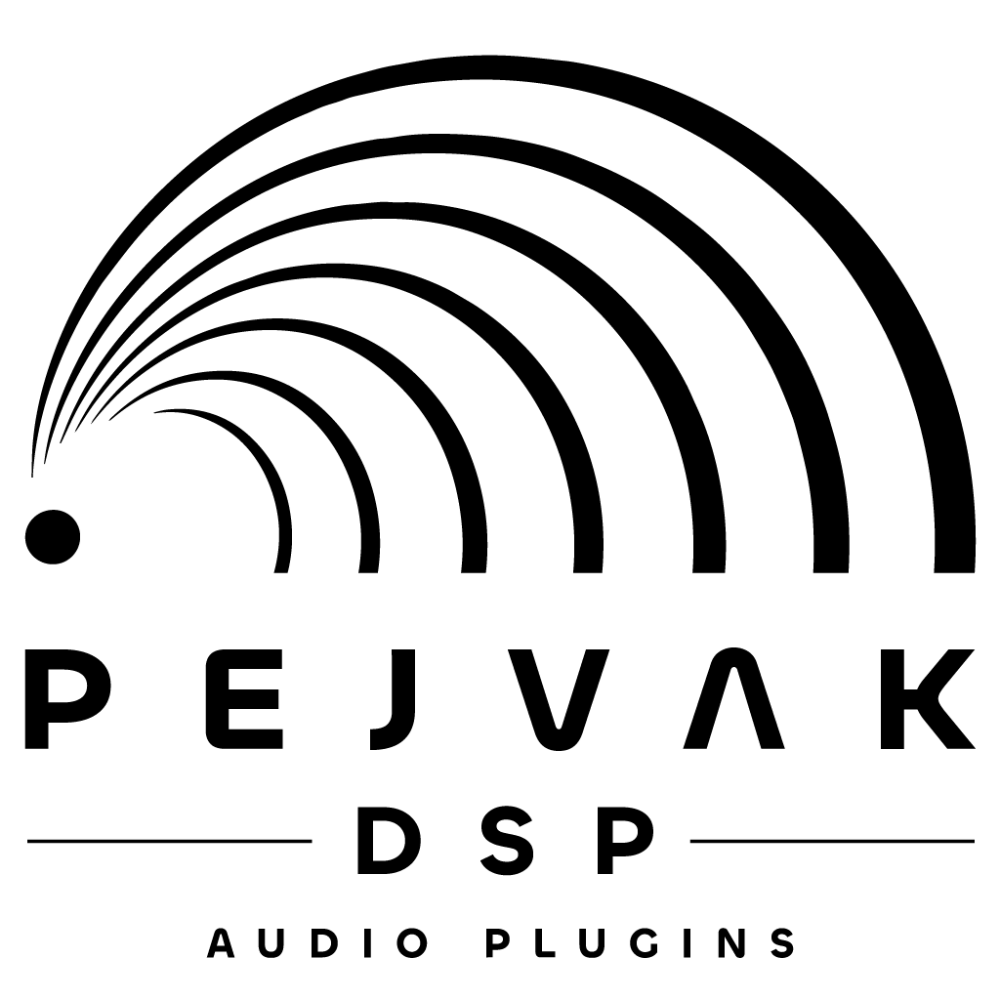
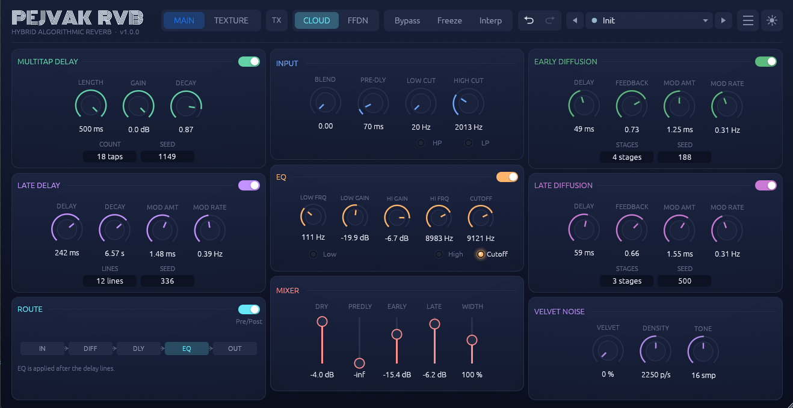
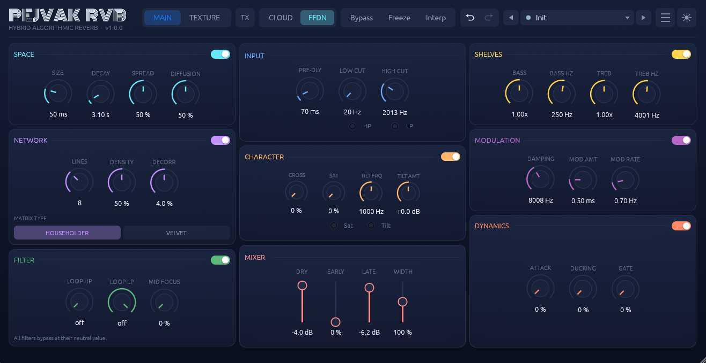
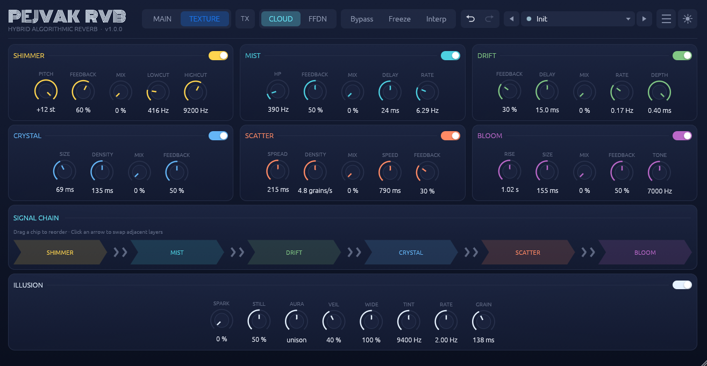

<div align="center">

<!-- ===== LOGO ===== -->


# 🎛️ PEJVAK RVB

**A Professional Hybrid Algorithmic Reverb — Dual Engine. Pure Rust.**

[](https://github.com/Pejvak-DSP/PejvakRVB/releases)
[](LICENSE)
[](https://www.rust-lang.org)
[](https://github.com/Pejvak-DSP/PejvakRVB/releases)

[](https://steinbergmedia.github.io/vst3_dev_portal/)
[](https://cleveraudio.org)
[](https://github.com/Pejvak-DSP)

</div>

<br>

> **PEJVAK RVB** is a high-end algorithmic reverb plugin written entirely in Rust. It combines two completely independent DSP engines in a single package — a faithful port of the legendary CloudSeed, and a modern Filtered Feedback Delay Network (FFDN) — and layers a rich, click-free texture system on top.
>
> **Design Goals:** Pure `f64` DSP, zero allocation on the audio thread, and a UI that feels as good as it sounds.

---

## Table of Contents

- [Features](#-features)
- [Screenshots](#-screenshots)
- [Installation](#-installation)
- [Building from Source](#️-building-from-source)
- [Project Structure](#-project-structure)
- [Contributing](#-contributing)
- [Credits](#-credits)
- [License](#-license)

---

## ✨ Features

### 🌌 Dual Engine Architecture

Switch seamlessly between two distinct worlds of reverb:

| Engine | Character | Highlights |
| :--- | :--- | :--- |
| **☁️ CloudSeed** | Warm, dense, and deep | Faithful port of [Valdemar Erlingsson's *CloudSeed* (legacy-v1)](https://github.com/ValdemarOrn/CloudSeed/tree/legacy-v1). 49 parameters, deep early-diffusion front-end, and Velvet-Noise diffusion. |
| **🌐 FFDN** | Clean, modern, and characterful | Filtered Feedback Delay Network. Features Householder & Velvet matrices, frequency-dependent attenuation, loop HP/LP filtering, mid-focus, modulated delay lines, Velvet saturation, spectral tilt, early reflections, and 3 dynamics stages (Attack / Ducking / Gate). |

*Switching engines instantly clears the departing engine's buffers, ensuring zero bleed-over from stale tails.*

### 🎨 Texture Rack (6 Layers)

Available on **both** engines. Drag the chips in the Signal Chain to reorder them:

- **Shimmer:** Granular pitch shifter inside a feedback loop.
- **Mist:** Short modulated delay with light feedback.
- **Drift:** Very slow pitch wobble.
- **Crystal:** Dual grain readers in a shared buffer.
- **Scatter:** Overlapping grains with random start positions.
- **Bloom:** Slow-rising reverse-reverb character.

*Every layer features a 20 ms anti-click smoother and clears its buffers on the rising edge from zero.*

### 🔮 ILLUSION — Granular Cloud

A beautiful granular cloud with pitched overtones. Features 8 parameters (Spark, Still, Aura, Veil, Wide, Tint, Rate, Grain) and 8 independent anti-click techniques, including Catmull-Rom cubic interpolation and soft-clip saturation.

### 🚀 Everything Else

- 🕹️ **Drag-and-Drop Signal Chain** with smooth animations and cursor feedback.
- ↩️ **Undo / Redo:** 50 steps with parameter-name tooltips. Undo never cuts the reverb tail.
- 🛑 **TX Kill Switch:** One-click master switch for all six texture layers and ILLUSION.
- 🎛️ **100 Factory Presets** across 16 color-coded categories.
- 🎨 **Dark / Light theme**, resizable UI (70% – 200%).
- 📖 **Bundled HTML Manual:** Features a sticky header, live search, and beautiful layout.
- 🧹 **Clippy-clean, bit-identical DSP:** Every output-stage gain is per-sample smoothed, neutral settings are covered by `*_is_bit_identical` tests, and the full 33-test DSP suite passes on every release.

---

## 📸 Screenshots

<div align="center">
  
  <br>
  <i>CloudSeed Engine — Warm and Dense</i>
</div>

<br>

<div align="center">
  
  <br>
  <i>FFDN Engine — Modern and Characterful</i>
</div>

<br>

<div align="center">
  
  <br>
  <i>Texture Rack &amp; ILLUSION</i>
</div>

---

## 📦 Installation

Download the archive for your platform from the [Releases](https://github.com/Pejvak-DSP/PejvakRVB/releases) page.

Every release ships with **one-click installer scripts** that handle the platform-specific quirks (Mark-of-the-Web unblocking on Windows, Gatekeeper/quarantine on macOS). If you prefer to install manually, the commands below are equivalent.

### 🪟 Windows

**Recommended:** run `Install_Windows.bat` from the release archive. It copies both formats to the correct system folders and unblocks the files (removing the "Mark of the Web" flag that would otherwise make Windows Defender warn on every load).

Manual installation (run PowerShell **as Administrator**):

```powershell
# CLAP
New-Item -ItemType Directory -Force -Path "C:\Program Files\Common Files\CLAP"
Copy-Item Pejvak_RVB.clap "C:\Program Files\Common Files\CLAP\"

# VST3
New-Item -ItemType Directory -Force -Path "C:\Program Files\Common Files\VST3\PEJVAK RVB"
Copy-Item -Recurse -Force Pejvak_RVB.vst3 "C:\Program Files\Common Files\VST3\PEJVAK RVB\"

# Remove the "Mark of the Web" flag
Get-ChildItem -Recurse "C:\Program Files\Common Files\VST3\PEJVAK RVB", "C:\Program Files\Common Files\CLAP\Pejvak_RVB.clap" | Unblock-File
```

### 🍎 macOS (Universal Binary)

**Recommended:** double-click `Install PEJVAK RVB.command` from the release archive. It removes the quarantine attribute and clears the Gatekeeper block, so the plugin loads in any DAW without the "cannot be opened" dialog.

Manual installation:

```bash
mkdir -p "$HOME/Library/Audio/Plug-Ins/VST3" "$HOME/Library/Audio/Plug-Ins/CLAP"
cp -R "PEJVAK RVB.vst3" "$HOME/Library/Audio/Plug-Ins/VST3/"
cp -R "Pejvak_RVB.clap" "$HOME/Library/Audio/Plug-Ins/CLAP/"

xattr -dr com.apple.quarantine "$HOME/Library/Audio/Plug-Ins/VST3/PEJVAK RVB.vst3"
xattr -dr com.apple.quarantine "$HOME/Library/Audio/Plug-Ins/CLAP/Pejvak_RVB.clap"
```

> **Note:** If macOS still blocks the plugin, go to **System Settings → Privacy & Security → Open Anyway**.

### 🐧 Linux

Distributed as a simple `tar.gz` archive — no installer script needed.

```bash
# VST3
mkdir -p ~/.vst3/"PEJVAK RVB.vst3"/Contents/x86_64-linux
cp "PEJVAK RVB.vst3/Contents/x86_64-linux/PEJVAK RVB.so" ~/.vst3/"PEJVAK RVB.vst3"/Contents/x86_64-linux/

# CLAP
mkdir -p ~/.clap
cp Pejvak_RVB.clap ~/.clap/
```

---

## 🛠️ Building from Source

Ensure you have **Rust 1.98+** installed.
(Linux users also need X11 and OpenGL development libraries — see [CONTRIBUTING.md](CONTRIBUTING.md#development-setup).)

```bash
git clone https://github.com/Pejvak-DSP/PejvakRVB.git
cd PejvakRVB
cargo nice-plug bundle Pejvak_RVB --release
```

The bundled plugins will appear in `target/bundled/`.

### ✅ Verifying the Build

The DSP suite is bit-identical by design — every neutral/default value is covered by a `*_is_bit_identical` test, and every stability-critical stage has a `*_keeps_network_stable` test. Before running the bundled plugins:

```bash
# 33 tests, all passing
cargo test -p fdn_reverb_core

# zero warnings across both crates, including tests
cargo clippy --workspace --all-targets -- -D warnings
```

### 🍏 macOS Universal Binary

```bash
rustup target add aarch64-apple-darwin x86_64-apple-darwin
cargo build --target aarch64-apple-darwin --release
cargo build --target x86_64-apple-darwin --release

mkdir -p target/universal/release
lipo -create \
  target/aarch64-apple-darwin/release/libPejvak_RVB.dylib \
  target/x86_64-apple-darwin/release/libPejvak_RVB.dylib \
  -output target/universal/release/libPejvak_RVB.dylib
```

The full release pipeline (all three platforms) is defined in [`.github/workflows/release.yml`](.github/workflows/release.yml).

---

## 🧱 Project Structure

```text
PejvakRVB/
├── fdn_reverb_core/        ← Pure DSP core (CloudSeed, FFDN, Textures)
│   └── src/
│       ├── cloudseed/      ← Faithful CloudSeed port
│       ├── ffdn/           ← Filtered Feedback Delay Network
│       └── texture/        ← Six texture layers + ILLUSION
├── Pejvak_RVB/             ← Plugin wrapper (params, UI, presets)
│   └── src/
│       ├── lib.rs          ← Plugin definition & Audio thread
│       ├── editor.rs       ← egui interface
│       ├── manual.rs       ← HTML manual loader
│       └── presets.rs      ← 100 factory presets
├── manual/                 ← Bundled HTML manual + logo
├── screenshots/            ← README images
├── .github/workflows/      ← Release CI (release.yml)
├── CHANGELOG.md
├── CONTRIBUTING.md
├── LICENSE
└── Cargo.toml              ← Workspace root
```

---

## 🤝 Contributing

Bug reports, feature requests, and pull requests are welcome. Please read [CONTRIBUTING.md](CONTRIBUTING.md) first — the real-time safety and DSP rules there are strict. See [CHANGELOG.md](CHANGELOG.md) for release history.

---

## 🙏 Credits

PEJVAK RVB stands on the shoulders of giants. Huge thanks to:

- **CloudSeed** — [Valdemar Erlingsson](https://github.com/ValdemarOrn/CloudSeed/tree/legacy-v1) (the original reference implementation)
- **CloudReverb** — [xunil-cloud](https://github.com/xunil-cloud/CloudReverb) (JUCE fork & modern parameter layout)
- **FFDN Theory** — Fagerström et al., "Velvet-Noise Feedback Delay Network" (DAFx 2020); Schlecht & Habets (IEEE TSP 2017); Välimäki et al. (IEEE/ACM TASLP 2017)
- **Granular Design** — Curtis Roads, *Microsound* (MIT Press, 2001)

Built with Rust, `nice-plug`, `egui`, and `wide`.

---

## 📄 License

This project is licensed under the **GNU General Public License v3.0 or later**.

```text
Copyright (C) 2025-2026 Pejvak DSP
Author: Amin Yousefinejad
```

See the [LICENSE](LICENSE) file for the full text.

<div align="center">

**Pejvak DSP** · Designed & developed by **Amin Yousefinejad**

<i>Made with ♥ for the audio community.</i>

</div>
